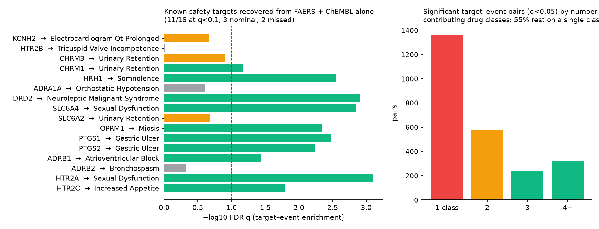

# Signal → Target

**An open, agent-executable atlas that links FDA FAERS safety signals to protein-target mechanisms.**
Prototype built 2026-10-24/25 as the pilot for a Google Antigravity for Science proposal.

Post-marketing pharmacovigilance finds *statistical* signals (drug X is reported with event Y more than expected), but regulators,
clinicians and drug developers need *mechanistic plausibility* before they act. Linking a signal to target biology today means
hand-searching FAERS, ChEMBL, UniProt, the Human Protein Atlas, Open Targets and the structural databases, one pair at a time.
Signal → Target automates that chain and tests it against known safety-target pharmacology.

## What the prototype does
1. **FAERS** (`s2t/faers.py`): downloads FDA quarterly ASCII files (2025Q3–2026Q2 here), deduplicates cases per FDA guidance
   (one version per `caseid`), keeps primary/secondary suspect drugs, matches drugs on active ingredient.
   → **1,533,688 deduplicated cases, 17,053 MedDRA PTs, 164 study drugs with ≥100 cases.**
2. **ChEMBL** (`s2t/chembl.py`): pulls human single-protein bioactivities (binding/functional assays) for 178 marketed drugs.
   → **3,227 drug–target pairs, 1,741 with pChEMBL ≥ 6 (≈1 µM), 692 targets.**
3. **Statistics** (`s2t/analyze.py`): ROR with 95% CI and BCPNN IC/IC025 for every drug–event pair; then, for every target with ≥4 active
   drugs, a one-sided Fisher test of whether signal-positive drugs are enriched among drugs active at that target; BH-FDR over all tests.
   → **105,401 drug–event pairs, 63,036 signals, 60,588 target–event tests, 2,495 at q<0.05.**
4. **Positive controls**: 20 textbook safety-target associations (Bowes et al. 2012 panel). **11 of 16 testable targets recovered at FDR<0.1,
   3 nominal, 2 missed** (`results/positive_control_recovery.csv`).
5. **Mechanism cards** (`results/mechanism_cards.json`): for a target–event pair, UniProt function, Human Protein Atlas expression,
   AlphaFold DB structure link and the per-drug potency + signal strength, i.e. the evidence a reviewer needs in one place.



## What the prototype shows is hard (the research)
**55% of significant target–event pairs rest on a single drug class** (every antipsychotic hits D1, D2 and 5-HT7 together; kinase inhibitors
"cause" neoplasm progression through their indication). Target attribution in FAERS is therefore confounded by pharmacological class
and indication. The 6–12 month project addresses exactly this:
- conditional and class-stratified enrichment, target-pair decorrelation, indication adjustment (propensity on reported indication);
- exposure-aware activity calls (unbound Cmax / XC50, after Smit et al. 2021) instead of a fixed 1 µM cut-off;
- scaling from 178 to all ~2,000 FAERS-reportable active ingredients and the full 2004–2026 archive, refreshed every FDA quarter;
- a hold-out benchmark of known safety-target associations for honest precision/recall, released with the atlas.

## Antigravity skill
`skills/faers_disproportionality/` is an Antigravity/`npx skills`-format skill (SKILL.md + scripts) that gives an agent reproducible FAERS
disproportionality with the right guardrails. The DeepMind `science-skills` plugin already wraps openFDA, ChEMBL, UniProt, HPA, Open Targets
and AlphaFold DB but has no signal-detection statistics; this skill is the missing piece and is intended as an upstream contribution,
together with evaluation scenarios built from the positive-control set.

## Reproduce
```bash
uv sync
uv run python -m s2t.chembl --drugs drugs.txt --out data/drug_target_pchembl.csv
uv run python -m s2t.faers --quarters 2026q2 2026q1 2025q4 2025q3 --drugs drugs.txt --out data/faers_processed.pkl
uv run python -m s2t.analyze --faers data/faers_processed.pkl --targets data/drug_target_pchembl.csv --out results
```

## Limitations (prototype)
Four quarters only; drug matching by active-ingredient substring; "inactive" includes untested drugs; a fixed pChEMBL cut-off ignores exposure;
spontaneous reports cannot give incidence or causality. All outputs are hypotheses for pharmacoepidemiological follow-up.

## Data sources
FDA FAERS quarterly files (public domain) · ChEMBL (CC BY-SA 3.0) · UniProt (CC BY 4.0) · Human Protein Atlas (CC BY-SA 3.0) · AlphaFold DB (CC BY 4.0).

Apache-2.0. Author: Sejal Kishor Daterao, California State University, Long Beach.
